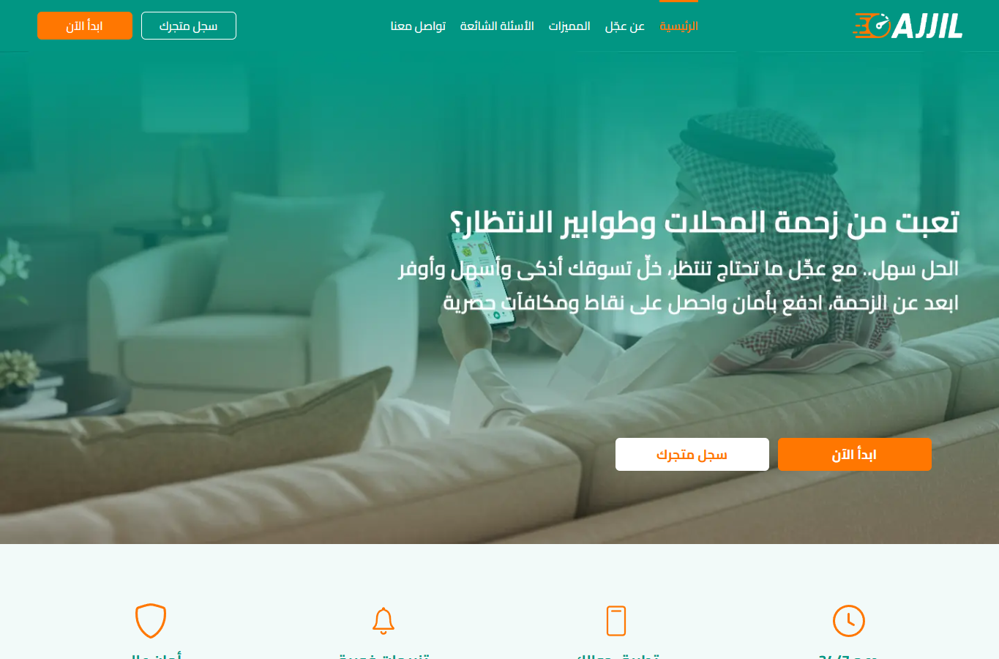
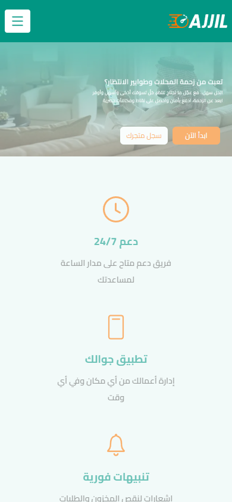
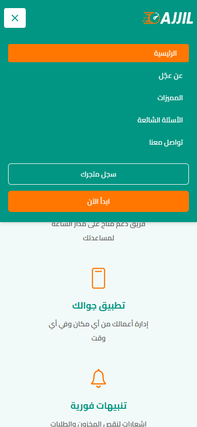
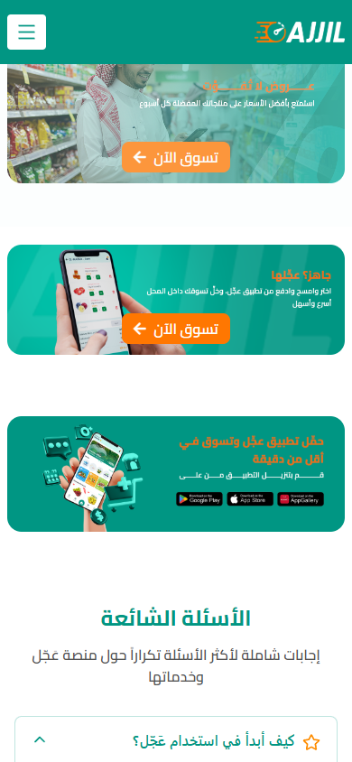
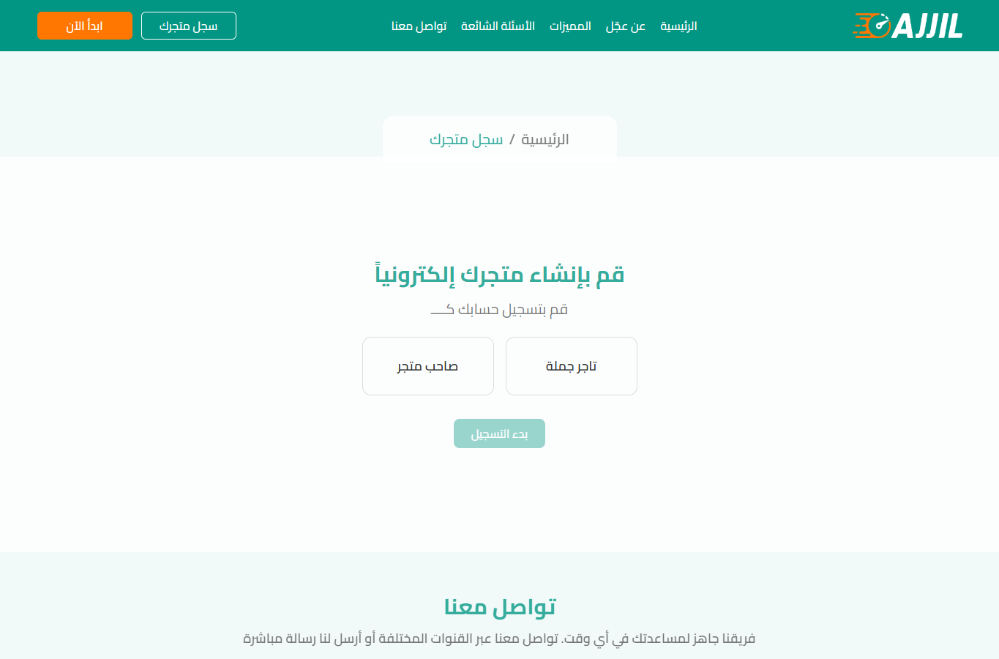
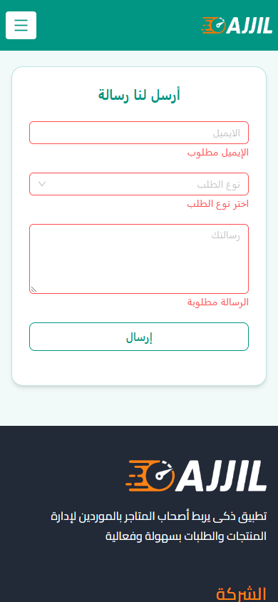
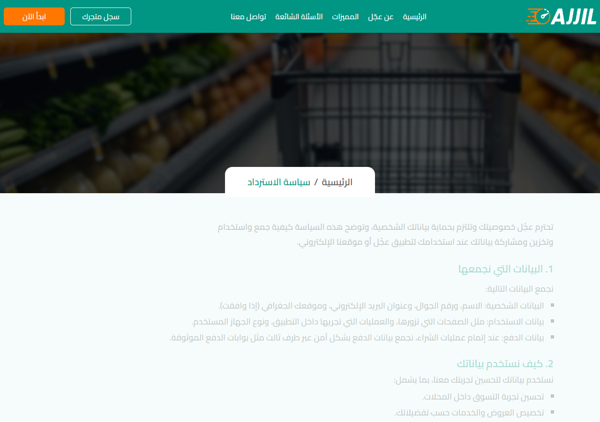
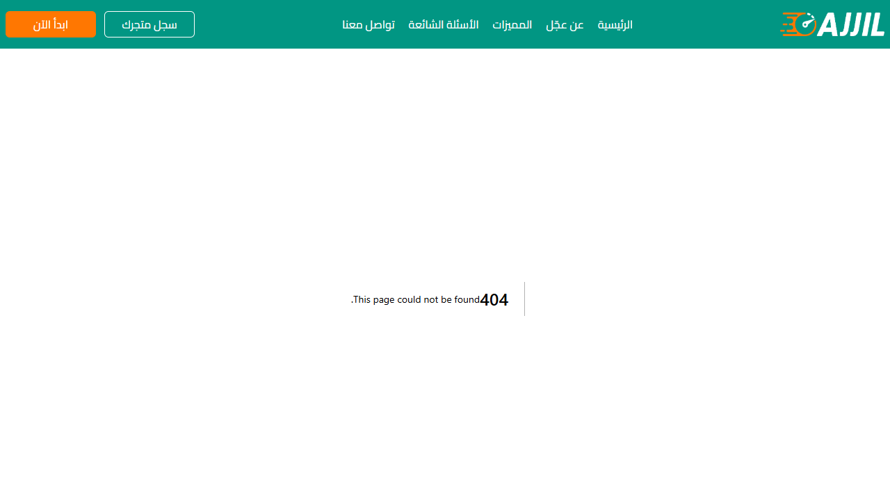
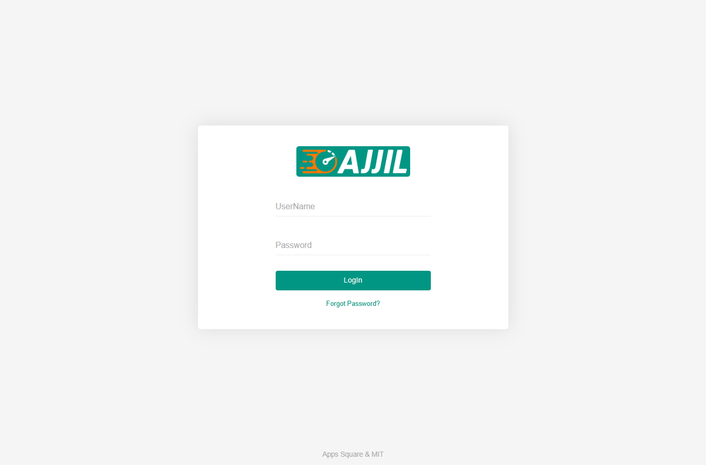

# Ajjil - Website UAT evidence gallery

Public, sanitized, evidence-only review for Ajjil / MIT. Anyone with the link can view these materials. No application source code, credentials, integration settings, customer records, session tokens, or raw authenticated traces are included.

## Recorded tests with directly viewable screenshots

### Website renders on desktop (WEB-R2-001, PASS)
Method: Chrome + Playwright, anonymous home GET, 1365 x 900 viewport.
Observed: Arabic/RTL home rendered; test ledger recorded HTTP 200.



### Mobile website and navigation (WEB-R2-002 and WEB-R2-003, PASS)
Method: Chrome + Playwright, 390 x 844 viewport. Observed: home rendered without recorded horizontal overflow; menu opened by pointer.





### FAQ expands (WEB-R2-005, PASS)
Method: Playwright clicked first FAQ accordion; test recorded visible answer and aria-expanded=true.



### Registration entry renders (WEB-R2-006, PASS, not end-to-end registration)
Method: Playwright anonymous GET /registration; observed two role choices and initially disabled Start action. No account submitted.



### Empty contact form validation (WEB-R2-008, PASS, not message delivery)
Method: Playwright selected Send with blank fields; all outgoing post-click requests were intercepted locally. Required messages appeared. No message was sent.



### Legal policy contents (WEB-R2-013, FAIL at test time)
Method: Chrome/Playwright visits to Terms, Privacy, Refund; the test ledger recorded identical normalized paragraph/list content hashes. The three captured pages below allow visual comparison; the hash is a recorded test result rather than a newly computed artifact here.
Recommendation: MIT should provide distinct, approved policy documents and rerun normalized content comparison.

**Terms**


**Privacy**


**Refund**



### Password reset historical observation (WEB-R2-014, FAIL then; subsequently partially fixed)
On 18 Oct 2026 the sampled /password/reset route returned 404, documented by screenshot. Round 3 later reported the route available and blank-field validation working. **Do not treat this historical 404 as an unresolved current issue.** Email delivery remains untested.



### Anonymous admin login renders (WEB-R2-015, UI observation only)
Method: anonymous HTTPS GET; page rendered. Screenshot does **not** prove or disprove the separately recorded JavaScript console error.



## New, optional transport check

When available, see [safe-http-headers.txt](evidence/network/safe-http-headers.txt). It is captured by the publish script with an anonymous `curl.exe` GET. It contains only HTTP status, `Location`, and `Strict-Transport-Security` headers, not any cookie or user values. Check the actual output before drawing a current conclusion.

Test method/commands:

```powershell
curl.exe -sS --max-redirs 0 -D - -o NUL http://ajjil-web.appssquare.com/
curl.exe -sS --max-redirs 0 -D - -o NUL https://ajjil-web.appssquare.com/
curl.exe -sS --max-redirs 0 -D - -o NUL http://back.ajjil.net/login
curl.exe -sS --max-redirs 0 -D - -o NUL https://back.ajjil.net/login
```

Recommendation: configure 301/308 HTTP-to-HTTPS redirects and an appropriate HSTS policy after confirming compatibility; retest each affected hostname and route. No claim of interception or exploitation is made.

## Integrity manifest

See [EVIDENCE-MANIFEST.csv](EVIDENCE-MANIFEST.csv) for SHA-256 checksums of each copied screenshot and the report.

## Additional written methodology

[MIT UAT test methods, recorded results and recommendations (PDF)](reports/AJJIL_Web_UAT_MIT_Evidence_Methods_Recommendations_2026-10-21.pdf)

The PDF describes prior recorded case-ledger results. This gallery contains the directly viewable screenshot evidence available in the published Web UAT branch. **A screenshot alone does not prove a DOM-level accessibility defect, backend security weakness, or JavaScript console event.** Such issues require their separate sanitized technical captures and are intentionally not presented here as independently screenshot-proven findings.

## Exclusions

No Unifonic settings values, product/customer/merchant data, original sensitive snapshots, authenticated screenshots, session cookies, SQL injection/XSS/IDOR tests, load testing, or unverified Master Catalogue acceptance claims are included. The main Ajjil repository remains private and separate from this evidence-only repo.
